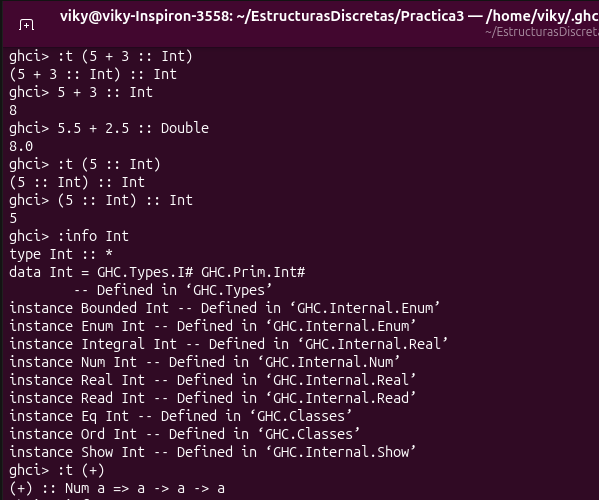
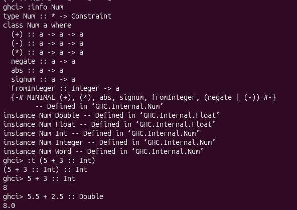

# Practica 02: Mis tipos de datos y listas por compresión

* ### Materia: Estructuras Discretas 
* ### Alumno: Herrera Bárcena Virginia Abigail
* ### Semestre: 2027 - 1
* ### Tiempo requerido: 5 horas  

***

## Objetivo:

#### El objetivo de esta práctica es familiarizar al alumno con las clases de tipo, la creación de tipos de dato y listas por compresión.

***

## Ejercicio 1.

#### ¿Cuál es la diferencia entre Num e Int?

#### Num es una clase de tipos, las cuales tiene como instancias tipos de datos como Int, Integer, Float , Double, etc. Int es un tipo de dato que representa números enteros de tamaño limitado que depende de la implementación y de la arquitectura utilizada.

#### Realiza un ejemplo en ghci, adjuntando una captura de pantalla.

## Ejercicio favorito

#### Mi ejercicio favorito fue el de la fución cetes, al inicio me tardé mucho haciendolo pero ya cuando lefui entendiendo me fue gustando un poco más, fue un poco complejo pero sin duda fue el que más me ayudó para hacer los demás ejercicios

